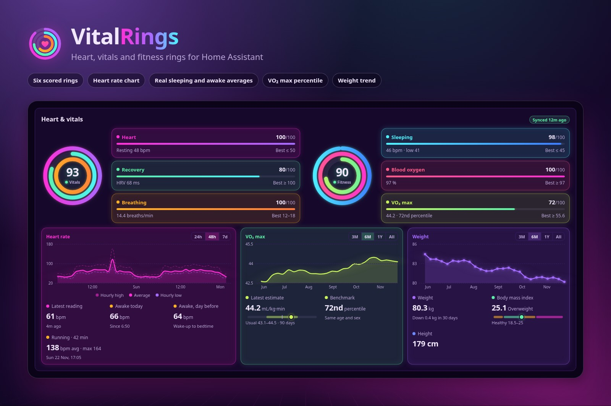
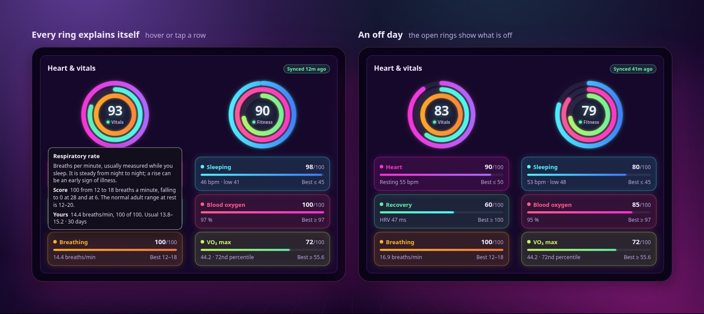
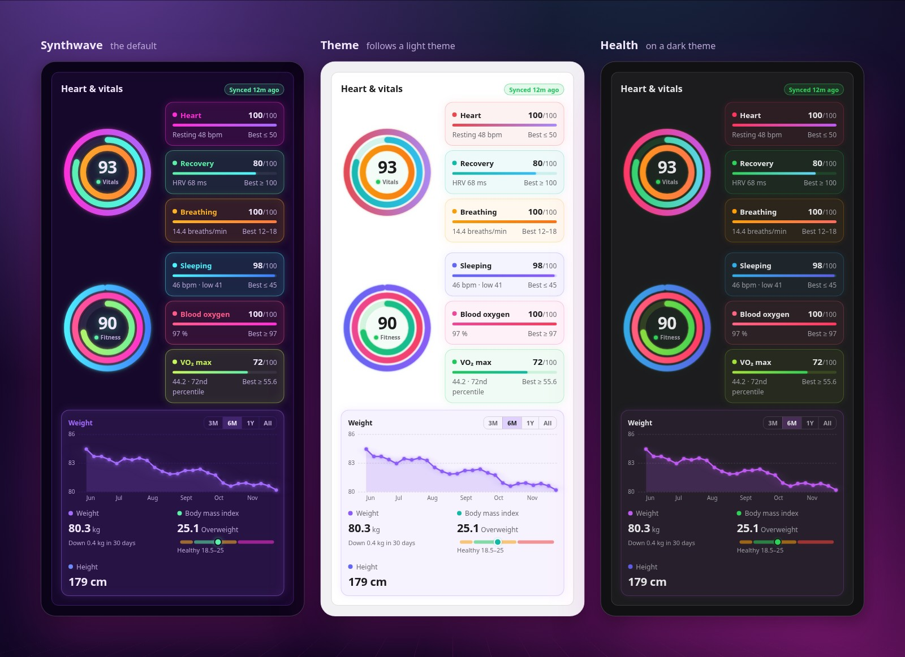

# VitalRings

<p align="center">
  
</p>

<p align="center">
  <a href="https://github.com/MulletBoy/vitalrings/releases/latest"></a>
  <a href="https://github.com/MulletBoy/vitalrings/actions/workflows/test.yml"></a>
  <a href="https://github.com/MulletBoy/vitalrings/actions/workflows/validate.yml"></a>
  
  <a href="LICENSE"></a>
  <a href="https://ko-fi.com/mulletboy"></a>
</p>

<p align="center">
  <a href="#install">Install</a> ·
  <a href="#the-card">The card</a> ·
  <a href="#how-the-rings-are-scored">Scoring</a> ·
  <a href="#entities">Entities</a> ·
  <a href="#privacy">Privacy</a>
</p>

Heart, vitals and fitness for Home Assistant, as rings you want to close. VitalRings takes the
health data your watch already sends to Home Assistant and scores six readings from 0 to 100
against published benchmarks, so a full ring is always good news. A sister project to
[SleepRings](https://github.com/MulletBoy/sleeprings).

VitalRings is one install: a custom integration that works out the figures, and a card that the
integration loads into your dashboards by itself.

VitalRings is free and stays free. If it earns a place on your dashboard, you can
[buy me a coffee on Ko-fi](https://ko-fi.com/mulletboy). ☕

<p align="center">
  
</p>

Three looks, and every colour can be changed:

<p align="center">
  
</p>

<sub>The screenshots show invented sample data, not anyone's health.</sub>

> VitalRings is not a medical device and gives no medical advice. The scores are a guide built
> from general reference ranges; they do not know your medical history.

## What it shows

- **Two sets of rings**, each ring a score out of 100 against a published
  benchmark, so a full ring is always good news:
  - **Vitals**: Heart (resting heart rate), Recovery (heart rate variability)
    and Breathing (respiratory rate).
  - **Fitness**: Sleeping heart rate, Blood oxygen and VO2 max.
- **Real averages**: sleeping heart rate from the hours you were asleep, awake
  heart rate since you woke up, and the day before for comparison.
- **Heart rate chart**: hourly average, high and low over 24 hours, 48 hours or
  7 days.
- **VO2 max**: its trend, your usual range and your percentile for your age
  and sex.
- **Body**: weight with its trend, body mass index and height, and a weight
  chart over 3 months to everything you have.

## What you need

- Home Assistant 2026.11 or newer, with the recorder (it is on by default).
- [Life Dashboard](https://github.com/owen282000/life-dashboard-ha) 1.4.0 or
  newer with its iOS companion app, which sends Apple Health data to Home
  Assistant. It is the only supported source so far; others can be added
  through a small adapter, see [Adding a source](#adding-a-source).
- The stock Home Assistant companion app is not enough: it reports only the
  latest heart rate when it happens to sync, with no history to average.

## Install

[](https://my.home-assistant.io/redirect/hacs_repository/?owner=MulletBoy&repository=vitalrings&category=integration)

1. Open **Settings > Marketplace**, choose **Add from link** and paste
   `https://github.com/MulletBoy/vitalrings` (type: Integration). On Home Assistant versions before
   2026.11 with HACS: **HACS > Custom repositories**.
2. Download **VitalRings** and restart Home Assistant.
3. Go to **Settings > Devices & services > Add integration > VitalRings**.
4. Choose whose health data to use (your Life Dashboard entry) and, optionally, your year of birth
   and sex. Those two are used only to pick the VO2 max benchmark.
5. Add the **Vital Rings** card to a dashboard and pick any VitalRings entity.

Manual install: copy `custom_components/vital_rings` into your `config/custom_components` folder
and restart.

## Entities

One device per person, with:

| Sensor | What it is |
|---|---|
| Vitals score | Mean of the Heart, Recovery and Breathing rings (0 to 100) |
| Fitness score | Mean of the Sleeping heart rate, Blood oxygen and VO2 max rings (0 to 100) |
| Sleeping heart rate | Average over the whole hours inside last night's sleep. Attributes: lowest, highest, hours, night |
| Awake heart rate | Average since this morning's wake-up |
| Awake heart rate previous day | From the previous morning's wake-up until you fell asleep |
| Resting heart rate 30-day average | With the 7-day average and the usual range as attributes |
| Heart rate variability 30-day average | Same |
| Workout heart rate | Average of the latest workout. Attributes: max, min, kind of workout, start, duration |
| Body mass index | With the WHO class as an attribute |

## The card

`custom:vital-rings-card`, added to every dashboard automatically (no resource
to register). Point it at any entity of the VitalRings device:

```yaml
type: custom:vital-rings-card
entity: sensor.vitals_sleeping_heart_rate
```

| Option | Default | |
|---|---|---|
| `entity` | | Any entity of a VitalRings device (required) |
| `name` | `Heart & vitals` | Title |
| `preset` | `synthwave` | `synthwave`, `theme` (follows your light or dark theme) or `health` |
| `show_rows` | `true` | A row beside the rings for each ring: score, reading and what earns full marks |
| `show_heart` | `true` | Heart rate chart, latest reading, awake averages and workout |
| `show_vitals` | `true` | VO2 max chart, usual range and percentile |
| `show_body` | `true` | Weight, body mass index, height and the weight chart |
| `heart_hours` | `48` | Period the heart rate chart opens on: `24`, `48` or `168` |
| `trend_range` | `6m` | Period the VO2 max and weight charts open on: `3m`, `6m`, `1y`, `all` |
| `weight_unit` | unit system | `kg` or `lb` |
| `tiles` | preset | Tinted boxes around each part |
| `theme_background` | `false` | Keep the theme's card background with the Synthwave preset |
| `colors` | | Override any colour, for example `resting: "#ff2fd6"` |

The card is one column wide by default and rearranges itself at two and three
dashboard columns.

## How the rings are scored

Each ring is a score from 0 to 100 that says where your value sits between
poor and excellent for a healthy adult. The benchmarks are reference ranges
from the literature turned into straight lines. That is a simplification: the
scores are a guide, not a medical judgement.

| Ring | Reading | 100 | 0 | Based on |
|---|---|---|---|---|
| Heart | Resting heart rate | 50 bpm or lower | 100 bpm | Normal adult range 60-100 bpm (American Heart Association); well-trained people rest at 40-60 |
| Recovery | Heart rate variability (SDNN) | 100 ms or higher | 15 ms | Higher is better. There is no agreed population table for wrist readings, so this is one broad scale for all adults, on a logarithmic scale |
| Breathing | Respiratory rate | 12 to 18 breaths/min | 28 and above, 6 and below | Normal adult range at rest 12-20 |
| Sleeping | Sleeping heart rate | 45 bpm or lower | 85 bpm | Runs below the resting rate |
| Blood oxygen | Oxygen saturation | 97 % or higher (95 % scores 85) | 90 % | 95-100 % is normal, below 90 % is low |
| VO2 max | VO2 max | 95th percentile or higher | below the 5th | Your percentile for age and sex in the FRIEND registry (Kaminsky et al., Mayo Clinic Proceedings 2015) |

The VO2 max benchmark needs your year of birth and sex, which you can give when
setting VitalRings up or later under **Configure**. Both are optional and stay
in your Home Assistant. Without them the 40-49 row and the mean of the men's
and women's values are used.

The number in the middle of each set is the mean of its three rings.

Hover a ring's row in the card (or tap it, or move to it with the keyboard) for
what it measures, how it is scored, and your own reading and usual range.

## How the figures are worked out

- **Sleeping heart rate** averages the hourly heart rate statistics that lie
  completely inside the night, so dozing off and getting up do not count. It
  needs at least two whole hours.
- **Awake heart rate** averages the whole hours since you woke up (or since
  midnight when no sleep was recorded last night).
- **Usual range** is the lowest and highest daily value of the last 30 days
  (90 days for VO2 max, which is measured only on some workouts).
- **Body mass index** is weight in kilograms divided by height in metres
  squared, with the World Health Organization's adult classes.
- Values that cannot be right (a heart rate of 900, a weight of 2 kg) are
  ignored.

## Privacy

- VitalRings makes no network requests. It only reads data another integration
  already holds in your Home Assistant.
- It stores nothing of its own: every figure is worked out again from the
  source's entities and long-term statistics. Your year of birth and sex, if
  you give them, are kept in the integration's settings like any other option.
- The sensors it creates are ordinary Home Assistant entities, so their history
  is recorded like any other sensor's, and anyone who can log in to your Home
  Assistant can read them and the card.
- Its diagnostics download contains no health values, times or entity ids.
- The card is one JavaScript file served by Home Assistant itself; it loads
  nothing from elsewhere.

## Adding a source

Sources live in `custom_components/vital_rings/sources/`. A source is a small class that says
where another integration keeps its health data: which entities carry the latest values, which
long-term statistics hold the history, and how to read its sleep and workout entities. See
`life_dashboard.py` and the `VitalsSource` protocol in `sources/__init__.py`. Everything after
that (averages, usual ranges, scores, sensors, the card) is shared.

## Development

```bash
pip install -r requirements-test.txt   # Python 3.14.2 or newer
ruff check . && ruff format --check . && pytest

cd card
npm ci --ignore-scripts
npm run build                          # also copies the bundle into the integration
node demo/build-demo.mjs               # dist/demo.html: the card with invented sample data
```

The images in this README are taken from `dist/demo.html?showcase`. The benchmarks are in
`custom_components/vital_rings/scores.py`, each with where it comes from.

## Support

VitalRings is a hobby project and free to use. Bug reports and pull requests are the most useful
support. If you would like to say thanks another way, there is
[Ko-fi](https://ko-fi.com/mulletboy).

## Credits

- [Life Dashboard](https://github.com/owen282000/life-dashboard-ha) by Owen Vogelaar provides the
  health data.
- The VO2 max benchmark is the FRIEND registry's reference standard: Kaminsky LA, Arena R, Myers J.
  *Reference Standards for Cardiorespiratory Fitness Measured With Cardiopulmonary Exercise
  Testing.* Mayo Clinic Proceedings, 2015.
- [ChromaFlow](https://github.com/Aresitoo/chromaflow) by AresLab inspired the look of the rings
  and rows.

## Licence

[MIT](LICENSE)
